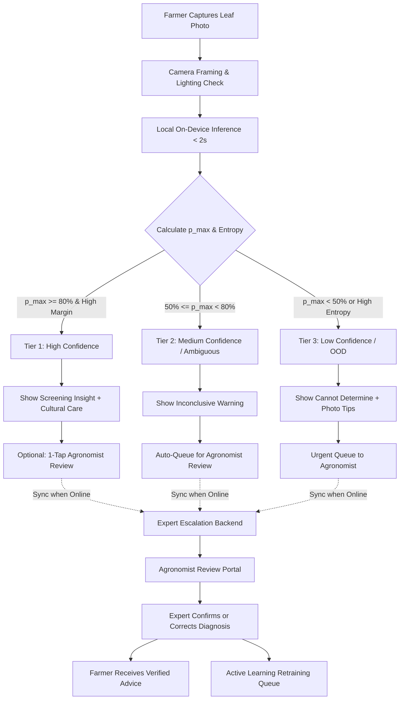
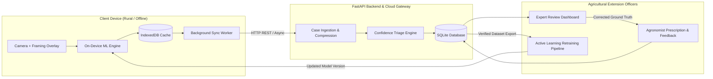

# Crop Disease Screening Aid: Architecture & Triage Specification

## 1. System Overview & Philosophy
The **Crop Disease Screening Aid** is designed specifically for smallholder farmers operating in low-connectivity, rural agricultural settings. 

> **CRITICAL CLINICAL PRINCIPLE**: 
> This tool functions strictly as an **early screening aid** and **triage router**. It **never** issues a final definitive diagnosis. Agricultural diseases have overlapping visual phenotypes (e.g., fungal leaf spots vs. nutrient deficiencies vs. bacterial leaf blights), and incorrect application of chemical pesticides causes financial ruin and soil degradation. The system is engineered to prioritize **human expert escalation** (agronomists, extension officers) whenever uncertainty exists.

---

## 2. Confidence-Threshold Triage Logic

Given an input crop photo $x$, the on-device lightweight convolutional neural network outputs a softmax probability vector $\mathbf{p} = [p_1, p_2, \dots, p_C]$ across $C$ candidate classes, with maximum probability $p_{\text{max}} = \max_i p_i$, runner-up probability $p_{\text{second}}$, and normalized prediction entropy:
$$H(\mathbf{p}) = -\frac{1}{\log C} \sum_{i=1}^{C} p_i \log p_i$$

### Triage Matrix

| Metric Threshold | Classification Tier | Farmer UI Display | Escalation Action |
| :--- | :--- | :--- | :--- |
| **$p_{\text{max}} \ge 0.80$** AND Margin $(p_{\text{max}} - p_{\text{second}}) \ge 0.35$ | **Tier 1: High Confidence Screening** | Shows identified crop & disease screening information, symptom checklist, and non-chemical cultural practices. Prominent reminder that this is an AI screening aid. | Stored locally; 1-tap optional "Request Agronomist Review" button available. |
| **$0.50 \le p_{\text{max}} < 0.80$** OR Margin $< 0.35$ | **Tier 2: Medium Confidence / Ambiguous** | Displays *"Possible [Disease Name] - Inconclusive"*. Clear warning: *"Symptoms resemble multiple conditions. Do not apply chemicals yet."* | **Auto-queued** for asynchronous extension worker review. Farmer notified when agronomist responds. |
| **$p_{\text{max}} < 0.50$** OR Entropy $H(\mathbf{p}) > 0.70$ OR Out-of-Distribution | **Tier 3: Low Confidence / Out of Distribution** | Displays *"Unable to determine crop condition"*. Guidance on taking clearer leaf photos (lighting, distance, focus). | **High-priority escalation** to agronomist triage queue with capture metadata. |

---

## 3. End-to-End System Architecture

The system operates across three synchronized tiers:

### Tier 1: Offline-First Client (PWA)
- **Live Camera Guide**: Visual overlay with leaf contour and dynamic luminance feedback (guides farmer to center leaf and ensure adequate sunlight).
- **On-Device Inference**: Runs client-side using a quantized model (MobileNetV3 / TFLite / ONNX Runtime Web). Executes in $<2$ seconds without server roundtrip.
- **Offline Storage & Sync Engine**: IndexedDB stores captured images, predictions, and offline requests. A background sync worker uploads queued cases when network connection is restored.
- **Multilingual Support**: Real-time localization in English, Swahili (Kiswahili), Hindi (हिन्दी), Tamil (தமிழ்), Spanish (Español), and French (Français).
- **Persistent Screening Banner**: Non-dismissible disclaimer across all screens.

### Tier 2: Escalation & Triage Backend (FastAPI)
- **Image Ingestion & Optimization**: Automatically compresses incoming field photos (WebP / JPEG 80% compression, resized to max 1280px) to save farmer cellular bandwidth.
- **Triage Router**: Evaluates confidence metadata and assigns priority status (`urgent_review`, `standard_review`, `resolved`).
- **Database (SQLite with WAL)**: Zero-friction, resilient storage for cases, farmer telemetry (location coordinates, timestamps, crop types), and expert audit logs.
- **Feedback Dispatcher**: Delivers expert prescription and advice back to the farmer client.

### Tier 3: Expert Review Dashboard & Active Learning Loop
- **Agronomist Portal**: High-efficiency web dashboard for agricultural extension workers.
  - Priority-ordered triage queue (Low confidence / OOD cases at the top).
  - Side-by-side inspection: farmer's leaf photo, top 3 AI predictions with confidence bars, field notes.
  - 1-click confirmation or override with standard 38-class PlantVillage taxonomy.
  - Structured treatment recommendations (Cultural / Organic / Safe Chemical Precautions).
- **Continuous Learning Loop**: Every expert-labeled correction is stored in an active learning pool (`/api/export/retraining`). When sufficient expert verifications accumulate, fine-tuning scripts update the model weights.

---

## 4. Dataset Considerations & Real-World Domain Gap

1. **Lab vs. Field Images (Domain Shift)**:
   - Datasets like **PlantVillage** were photographed primarily in indoor lab settings against monochrome gray/black backgrounds.
   - Real-world field photos contain soil, weeds, severe sunlight glare, and shadows.
   - **Mitigation in this design**:
     - Guided camera framing in client to isolate single leaf against neutral backing if possible.
     - On-the-fly aggressive spatial and chromatic augmentations during training (shadow injection, color jitter, blur).
     - Strict entropy thresholding that rejects cluttered or non-leaf photos as "Out of Distribution".
2. **Active Learning as Continuous Bridge**:
   - Field photos reviewed and labeled by human extension workers provide high-value, authentic field data to close the domain gap over successive model versions.
