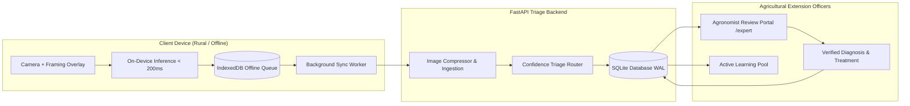

# 🌿 Crop Disease Screening Aid for Smallholder Farmers

A real-time, photo-based **crop disease screening aid** and **triage router** tailored for rural smallholder farmers. 

> ### ⚠️ CLINICAL PRINCIPLE: SCREENING AID ONLY
> This system is intentionally designed as an **early screening aid and triage router**, **NEVER a definitive diagnosis**. 
> Visual plant pathology symptoms frequently overlap (e.g. fungal leaf spots vs. nutritional chlorosis vs. bacterial blights). Unwarranted chemical spraying wastes smallholder income and harms ecology. Therefore, this tool **prioritizes human agronomist escalation** whenever uncertainty exists.

---

## 📐 Architecture Overview



---

## 🎯 Confidence-Threshold Triage Logic

When a leaf photo is processed, the system analyzes top confidence $p_{\text{max}}$, runner-up confidence $p_{\text{second}}$, margin $\Delta = p_{\text{max}} - p_{\text{second}}$, and normalized prediction entropy $H(\mathbf{p})$:

| Threshold Criteria | Tier | UI Display to Farmer | Backend Escalation Action |
| :--- | :--- | :--- | :--- |
| **$p_{\text{max}} \ge 0.80$** AND $\Delta \ge 0.35$ | **Tier 1: High Confidence Screening** | Shows crop condition, symptom checklist, and non-chemical cultural field practices. Persistent disclaimer displayed. | Stored locally; 1-tap optional "Request Agronomist Review" button. |
| **$0.50 \le p_{\text{max}} < 0.80$** OR $\Delta < 0.35$ | **Tier 2: Medium Confidence / Ambiguous** | Displays *"Possible [Disease] - Inconclusive. Do not spray chemicals yet."* | **Auto-enqueued** for human extension worker review. |
| **$p_{\text{max}} < 0.50$** OR $H(\mathbf{p}) > 0.70$ OR Out-of-Distribution | **Tier 3: Low Confidence / OOD** | Displays *"Unable to determine crop disease reliably"*. Tips on leaf framing and sunlight. | **Urgent priority escalation** to agronomist queue. |

---

## 🚀 Key Features

1. **Mobile/Web PWA Client (`client/`)**:
   - **Camera Framing & Dynamic Luminance**: Real-time feedback guides the farmer to center a single leaf and alerts them if lighting is too dark or has harsh glare.
   - **On-Device Inference (<200ms)**: Operates without internet connectivity, avoiding costly cellular data.
   - **100% Offline Capability**: Uses IndexedDB and Service Worker. Automatically queues offline screenings and syncs when back in network coverage.
   - **Multi-Language Support**: Immediate toggle between English, Kiswahili (Swahili), Hindi (हिन्दी), Tamil (தமிழ்), Spanish (Español), and French (Français).
   - **Non-Dismissible Safety Banner**: Constant warning against premature pesticide application.

2. **FastAPI Triage Backend (`backend/`)**:
   - **Bandwidth Optimization**: Compresses high-resolution leaf snapshots (Pillow LANCZOS, JPEG 80% quality, max 1024px) and generates 256px thumbnails.
   - **Escalation Routing**: Evaluates confidence tiers and assigns queue priority (`urgent_review`, `standard_review`, `farmer_requested`).
   - **Lightweight Persistence**: Embedded SQLite with WAL mode (`crop_disease.db`).

3. **Agronomist Escalation Portal (`expert_portal/`)**:
   - Web-based dashboard for extension officers to review queued farmer cases.
   - Side-by-side inspection: High-res leaf image viewer, AI confidence breakdown, runner-up class, entropy, and farmer notes.
   - One-click ground truth confirmation or correction across 38 PlantVillage classes.
   - Prescription builder for non-chemical cultural interventions and pesticide precautions.

4. **Active Learning & Retraining Loop (`ml/`)**:
   - Every expert review records whether human and AI agreed (`agreement: 0` or `1`).
   - `ml/retrain_active_learning.py` pulls expert-corrected field cases, calculates field accuracy, and updates the model version (`v1.0.0` $\to$ `v1.1.0`).
   - Bridges the **domain gap** between laboratory datasets (e.g. PlantVillage plain backgrounds) and real-world cluttered field photography.

---

## 🛠️ Project Structure

```text
Crop Disease Detection/
├── ARCHITECTURE.md                  # Comprehensive architectural specification
├── README.md                        # Documentation & quick start guide
├── requirements.txt                 # Backend & ML package dependencies
├── backend/
│   ├── app.py                       # FastAPI server (APIs, image intake, static mounts)
│   ├── database.py                  # SQLite schema, case storage, expert reviews
│   ├── triage.py                    # Confidence-threshold & entropy triage engine
│   └── uploads/                     # Compressed leaf image storage
├── client/
│   ├── index.html                   # Farmer PWA interface (framing, camera, results)
│   ├── styles.css                   # High-contrast, sunlight-readable mobile UI
│   ├── app.js                       # On-device screening, IndexedDB, offline sync
│   ├── translations.js              # Localization dictionary (6 languages)
│   ├── sw.js                        # Service worker for offline asset caching
│   └── manifest.json                # PWA Android install manifest
├── expert_portal/
│   ├── index.html                   # Agronomist review queue & inspector
│   ├── dashboard.css                # Extension worker dashboard styles
│   └── dashboard.js                 # Case triage, verification form, active learning export
├── ml/
│   ├── labels.json                  # 38 PlantVillage classes + non-plant OOD class
│   ├── model_metadata.json          # Model version, calibration parameters, thresholds
│   ├── train_pipeline.py            # MobileNetV3 transfer learning & field augmentation
│   ├── retrain_active_learning.py   # Continuous learning loop using expert corrections
│   └── export_model.py              # Export weights to ONNX format
└── tests/
    └── test_triage.py               # Automated unit tests for triage & database
```

---

## 🏃 Getting Started

### 1. Install Dependencies
```bash
pip install -r requirements.txt
```

### 2. Run Automated Unit Tests
```bash
python -m unittest tests/test_triage.py
```
*(All 6 tests validate Tier 1/2/3 confidence routing, narrow-margin ambiguity, entropy, and expert audit storage).*

### 3. Launch the Application Server
```bash
python -m uvicorn backend.app:app --host 0.0.0.0 --port 8000 --reload
```

- **Farmer Mobile Screening PWA**: [http://localhost:8000/](http://localhost:8000/)
- **Agronomist Escalation Portal**: [http://localhost:8000/expert](http://localhost:8000/expert)
- **Interactive OpenAPI Documentation**: [http://localhost:8000/docs](http://localhost:8000/docs)

### 4. Run Active Learning Cycle
Once agronomists submit case reviews, trigger the continuous retraining loop:
```bash
python ml/retrain_active_learning.py
```
This increments the model version in `ml/model_metadata.json` and prepares the dataset for the next model release.
